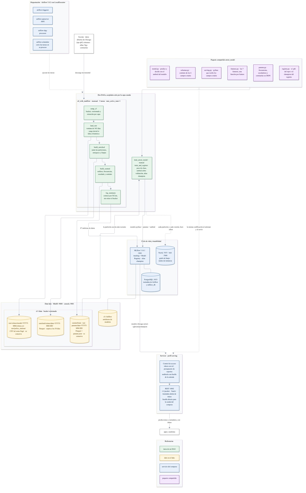
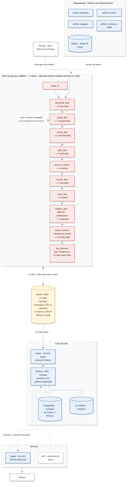

# Arquitectura del TP integrador

Plataforma de predicción en tiempo real de "ML Models & Something More Inc." que sirve el modelo XGBoost de arrestos en Chicago (2024). Nivel en contenedores.

Parte de la infraestructura del TP final de MLOps I y le aplica encima los conceptos de la materia. Lo que sigue es qué cambió y por qué.

Equipo: trabajo individual. Bel Cattaneo cubre diseño, implementación y documentación.

Se levanta con `make stack-up`; el detalle está en [cómo levantarla](plataforma.md).

Los diagramas se generan desde `arquitectura.mmd` y `arquitectura-mlops1.mmd` con `make diagramas`.

## De dónde se parte

La infraestructura viene del TP final de MLOps I, y vale la pena ver las dos arquitecturas juntas porque la diferencia no está en la cantidad de servicios.

| | MLOps I | MLOps II |
|---|---|---|
| ejecutor de Airflow | Celery, con worker y ValKey de broker | LocalExecutor: las tareas corren en el proceso del scheduler |
| el pipeline | un DAG de 11 tareas, una por etapa | un DAG de 5 tareas, una por capa |
| lo que deja en el lake | el dataset entero entre paso y paso, en 9 prefijos numerados de `0-raw-data/` a `ml-ready-data/`: 13 objetos y 348,95 MB de CSV por corrida | tres capas con nombres de dominio y retención propia: 3 Parquet y su `params.json`, 8,64 MB por corrida |
| la ventana móvil | `merge_data` releía el último archivo mergeado y le concatenaba el mes nuevo | la determinan qué particiones mensuales caen en los últimos 365 días |
| el entrenamiento | un servicio `trainer` aparte | un DAG propio, acoplado al ETL solo por la capa curada |
| de dónde sale el modelo que se sirve | del artefacto que dejó el entrenamiento | del Model Registry, por el alias `champion` |
| los parámetros de preprocesamiento | quedaban del lado del pipeline | viajan dentro del artefacto del modelo |
| el umbral de decisión | un `0.5` escrito en el código | lo elige el entrenamiento sobre validación y viaja con el modelo |
| protocolos de servicio | una API REST | una API REST, elegida midiendo contra gRPC y GraphQL en vez de por defecto |
| quién puede predecir | cualquiera que llegue al puerto | token firmado con rol, presupuesto por usuario y una línea de auditoría por request |
| el resumen de la corrida | bajaba 7 datasets de S3 para contar filas | los conteos viajan por XCom |

La diferencia de fondo es que en MLOps I el pipeline era una cadena de archivos, donde cada etapa dependía de que la anterior hubiera dejado el suyo en el lugar justo. Ahora es un contrato: el ETL publica una capa curada que cumple el contrato de features de `arrest_model`, y el entrenamiento la consume sin saber quién la escribió.

## Decisiones de arquitectura

### Un solo protocolo de servicio, y es REST

La plataforma sirve el modelo por REST. No porque REST sea mejor en abstracto —medimos que gRPC es más rápido— sino porque a la carga de este problema esa ventaja no compra nada.

**El volumen.** El portal publica 633 reportes por día. Eso es 26,4 por hora, 0,44 por minuto, uno cada 136 segundos: 0,007 predicciones por segundo. Con la mediana medida de una llamada REST dockerizada —4,94 ms con keep-alive— el servicio estaría ocupado el 0,0036% del tiempo.

**Lo que gRPC ahorraría.** Dockerizado y reusando el canal, gRPC responde en 2,81 ms contra los 4,94 de REST: 2,13 ms por llamada, 1,76x. A 633 llamadas por día eso son **1,35 segundos por día**, 8 minutos por año. El costo de obtenerlos es un servicio más en el compose, una imagen más que mantener, un `.proto` que versionar y un puerto más que asegurar.

**Y la forma de la carga no es de a uno.** Los reportes llegan en lote, con 12 días de atraso del portal, así que lo que la plataforma hace es puntuar conjuntos y no eventos sueltos. Ahí la comparación se da vuelta: el lote de 100 por REST tarda 6,92 ms y el mismo lote por `PredictStream` de gRPC, 13,46 ms. **REST le gana a gRPC por 1,95x en las seis corridas medidas.**

Las mediciones están en [`tp3_grpc/latencias.md`](../tp3_grpc/latencias.md), con cuatro cohortes medidas tres veces cada una.

### GraphQL tampoco entra

Su ventaja medida es traer solo los campos pedidos: 89 bytes contra 557 de REST para la misma consulta de metadatos. Es real, y es irrelevante acá: son metadatos que se consultan de vez en cuando, y 468 bytes no pagan un contenedor, una imagen y un puerto más.

Lo único que GraphQL aportaba y nadie más tenía era el linaje del modelo. Su grafo estaba escrito a mano y describía el pipeline de MLOps I —con etapas que este pipeline ya no tiene—, así que se borró junto con el servicio.

La trazabilidad que la plataforma sí tiene es la de MLflow: cada versión registrada guarda de qué partición curada salió, y esa partición está en el lake con sus parámetros. De ahí para atrás la cadena es determinista, porque la ventana son los 365 días previos a la fecha de la partición.

Lo que MLflow no contesta es la pregunta al revés —"este mes del portal vino mal, ¿qué versiones hay que revisar?"— que es un recorrido hacia adelante de profundidad desconocida. Para eso la plataforma mantiene un grafo en Neo4j con nodos de **instancia**, escrito por el pipeline mientras corre: una partición cruda, una intermedia, una curada y una versión del modelo, encadenadas por `DERIVES`.

Escribirlo es best-effort, así que una caída de Neo4j no voltea el pipeline de datos, y el resumen de la corrida registra `lineage_written` para que el hueco no quede en silencio.

### Por qué esto no contradice los mini-TPs

Los mini-TPs comparan REST, GraphQL y gRPC sobre el mismo modelo: ese es su objetivo y ahí la comparación tiene sentido. La plataforma no compara, sirve. Tiene un tipo de consumidor, así que tiene un protocolo.

Sobredimensionar la arquitectura tiene un costo que no se ve en un diagrama: cada servicio de más es una imagen que reconstruir, una superficie que asegurar y una versión que mantener alineada con el paquete compartido.

### Seguridad del servicio

La API dejó de ser anónima: cada predicción tiene un responsable. Todo `/v1` pide un token firmado con HS256 que lleva quién es y con qué rol —401 sin credencial, 403 con una válida cuyo rol no alcanza—, y el vencimiento es de quince minutos, porque lo que limita el daño de una credencial filtrada es cuánto dura y no cuán largo sea el secreto. `/v1/metadata` pide token aunque no prediga: publica las métricas, las features y el umbral de decisión, que es justo lo que necesita quien quiera entrenar un sustituto del modelo. `/health` queda abierto porque lo usa el healthcheck del compose y una sonda con credenciales es un problema operativo en sí mismo; informa el estado y la versión cargada, no las métricas ni el umbral.

**El presupuesto se cuenta en reportes y no en llamadas**, porque una llamada puede traer mil y limitar llamadas no acota el trabajo. Los números salen del volumen medido: 633 reportes por día, 0,44 por minuto. El tope por minuto son dos lotes máximos, 2000, y el del día 5000, unas ocho veces el volumen real, así que ningún consumidor legítimo los ve. Un solo lote por minuto se descartó midiendo contra la plataforma: con el tope igual al lote máximo, una predicción suelta en el mismo minuto vuelve imposible la llamada más grande que el contrato permite. Se cobra después de validar y antes de predecir, así que un reporte fuera de Chicago no le gasta cupo a nadie.

Lo que el límite compra no es imposibilidad: un atacante que consulta sin tope reconstruye la frontera de decisión preguntando, y con tope diario eso se vuelve lento y **visible**. Lo visible es el registro de auditoría: cada request deja una línea con usuario, status, latencia, versión del modelo y la huella de la entrada —SHA-256 de los reportes ya normalizados, truncada—. Es la huella y no el reporte porque un reporte trae la latitud y la longitud de un hecho: conservarlo entero convertiría el registro en una segunda base de datos personales. Con la huella alcanza para lo que sirve, probar que dos consultas fueron por lo mismo y atar cada respuesta a su entrada. Los rechazos se registran igual, porque el pico de 401 o de 429 es la señal que hay que poder ver después.

El secreto viene del entorno y el servicio **no arranca sin él**, ni siquiera corriendo la imagen a mano: servir sin control exige decirlo en voz alta, con `REST_AUTH=off`, y es lo que hacen los targets del mini-TP 1, que es una entrega aparte y se entrega abierta. El default es el seguro; lo explícito es abrirlo. Los tokens los firma el propio servicio dentro de su contenedor, con `make stack-token`, así el secreto no tiene que salir de ahí; en producción el emisor es un IdP y el servicio solo verifica.

**Una credencial por servicio.** Hasta acá los servicios del compose compartían la credencial root de MinIO: ocho la llevaban como credencial de S3 en su entorno, y contando el que crea los buckets y el propio MinIO eran diez de los doce. Cualquiera de ellos podía borrar el data lake entero, y asegurar la API dejando eso sería asegurar la puerta y abrir la ventana. Ahora el contenedor que crea los buckets crea también un usuario por servicio con su política: Airflow es dueño del bucket de datos —lo crea, le pone versionado y retención— y escribe artefactos en el de MLflow; MLflow administra el suyo; el servicio que sirve el modelo solo lee. La root queda en MinIO y en ese contenedor de arranque. Verificado contra la plataforma: con la credencial del servicio REST, escribir en `s3://mlflow` o leer `s3://data` dan `AccessDenied`, y el entrenamiento siguió registrando versiones con la suya.

Qué no cubre: el estado del presupuesto vive en memoria del proceso, así que con más de una réplica el límite efectivo se multiplica —la plataforma corre una sola, y escalarla pide mover ese estado a un almacén compartido—, y la auditoría va al log del contenedor, que es lo que persiste, y no a un almacén de solo-agregar.

## Capas

| capa | componentes | qué hace |
|---|---|---|
| Ingesta y orquestación | Airflow | el DAG de ETL baja los reportes de Socrata y los procesa |
| Data lake | MinIO | guarda los datasets en tres capas —`raw`, `enriched` y `curated` de `s3://data`— y los artefactos de modelos (`s3://mlflow`) |
| Entrenamiento y ciclo de vida | Airflow, MLflow, PostgreSQL | el DAG `train_arrest_model` entrena sobre la capa curada y registra el modelo con el alias `champion` |
| Servicio | una API REST | predicciones y metadatos del modelo `champion`, que trae su propia codificación adentro y recibe los campos crudos, detrás de token con rol y presupuesto |
| Trazabilidad | MLflow, Neo4j | de qué partición salió cada versión, y el grafo que recorre la cadena entera en las dos direcciones |

## Qué concepto de la materia aplica cada decisión

| sesión | el concepto | cómo lo aplica la plataforma |
|---|---|---|
| S1 · Del modelo al servicio | predicción online en contenedores, contrato validado, versionado de API y de modelo, qué monitorear | el payload se valida antes de llegar al modelo; la versión servida sale del registro y viaja en cada respuesta; `/health` distingue "el proceso está arriba" de "hay modelo cargado" |
| S2 · Grafos de linaje | el linaje dato → feature → modelo como grafo, para trazabilidad y auditoría | Neo4j con nodos de instancia que el pipeline escribe al correr, y la consulta multi-hop en las dos direcciones |
| S3 · gRPC | contrato tipado y binario para la inferencia interna de baja latencia | medido contra REST sobre el mismo modelo y descartado para esta carga, con los números de arriba; el servidor queda como entrega del mini-TP 3 |
| S4 · Streaming | inferencia online sobre un flujo, features por ventana, monitoreo continuo | no se incorporó a la plataforma: el pipeline es mensual y la inferencia, a pedido |
| S5 · Aprendizaje federado | mover el cómputo al dato, agregar solo parámetros | no se incorporó: los datos del portal de Chicago son públicos y están centralizados, así que no hay dilema del dato que resolver |
| S6 · Nube y data lake | zonas del lake, *schema-on-read*, Parquet en lo curado, un solo origen de verdad | las tres capas de `s3://data` con retención propia y el bucket versionado; el lake es lo único que acopla el ETL con el entrenamiento |
| S7 · Seguridad y gobernanza | autenticación, cifrado, auditoría, model card | token con rol sobre todo `/v1`, presupuesto de reportes por usuario y una línea de auditoría por request con la huella de la entrada; una credencial de MinIO por servicio en vez de la root compartida; la [model card](model-card.md) con los límites y las consideraciones éticas del modelo servido |

## Hoja de ruta

| hito | fecha | qué se presenta |
|---|---|---|
| Hito #1 · arquitectura | 17/09 | este documento |
| Hito #2 · checkpoint | 01/10 | la infraestructura de MLOps I levantada con los tres servicios y la capa de streaming |
| Defensa | 15/10 | la plataforma completa y la presentación |
| Repositorio final | 22/10 | el repo y las slides |

## Créditos

La infraestructura parte del [TP final de MLOps I](https://github.com/CEIA-22Co2025-Grupo4/MLOPS) del grupo CEIA-22Co2025-Grupo4, basado en [amq2-service-ml](https://github.com/facundolucianna/amq2-service-ml) de la cátedra.
